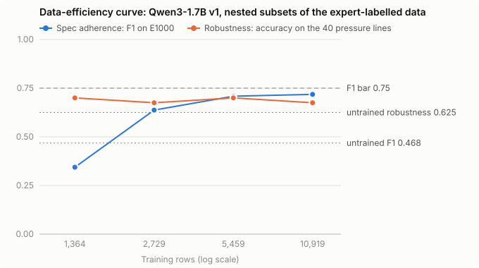

# Small model report: base vs tuned, the data fix and the data-efficiency curve

Runs 2026-10-29 and 2026-10-30. Every number below comes from [results/slm_results.md](../results/slm_results.md), which `scripts/slm_results.py` builds from the per-message run files in `runs/` and the training logs in [results/train_logs/](../results/train_logs/). Models are Qwen3-1.7B with a LoRA adapter trained by QLoRA; all are scored in bf16.

## Summary

- **Fine-tuning works on the benchmark.** Trained on the 10,919 expert-labelled training messages, the 1.7B model goes from F1 0.468 to 0.718 on `E1000` and from precision 0.466 to 0.823. Both gains have intervals well clear of zero.
- **The tuned model clears the precision bar and misses the F1 bar.** The shipped model (v2) scores precision 0.857 and F1 0.698 against a bar of 0.80 and 0.75. Claude Opus 5.5's best prompt scored precision 0.624 and F1 0.687, so the 1.7B model matches the best frontier cell on F1 and raises precision by 0.23. It runs at about 0.13 s per message in batches of 32 on a laptop GPU, against the frontier cell's median of 1.3 s per message. v2 retrained with a second seed scored precision 0.875 and F1 0.724: the same verdict on both bars.
- **The data fix helped a little, not enough.** 676 teacher-written lines aimed at v1's failures moved the pressure set from 27 to 30 of 40 and left the benchmark where it was. Sarcasm and taunts are still mostly missed. With a second seed, one gain repeats cleanly: both v2 seeds flag `jg diff`, and neither v1 seed does.
- **Training noise is as large as the data fix.** Retraining v1 with only the seed changed moved its precision by 0.056 (0.01 to 0.11). The data fix moved precision by +0.034 in one seed and −0.004 in the other.
- **A heavier dose of the teacher lines traded precision for recall.** v3 repeats each teacher line 4 times, a fifth of its data. Its precision fell by 0.118 (0.05 to 0.19) to 0.739, below the bar, and F1 didn't move. It caught one sarcastic pressure line, and started flagging sarcasm-shaped benchmark lines that the experts label fine.
- **The small model sees sarcasm; its labels taught it not to flag it.** Asked whether a line is sarcastic, v2 tells sarcastic from sincere chat about as well as Claude. Asked whether it is toxic, it rates sarcasm far below insults, as the experts' labels do.
- **The minimum N is about 5,500 expert-labelled rows.** In both training seeds, 5,459 rows score within noise of the full 10,919 (F1 +0.010 and −0.015 for the full set). Below that, at 1,364 rows, the seed alone moved F1 from 0.344 to 0.619. No size reached the F1 bar.

## Base vs tuned

| Model | Precision | Recall | F1 (95% CI) | Pressure set |
| --- | --- | --- | --- | --- |
| Qwen3-1.7B, untrained | 0.466 | 0.471 | 0.468 (0.38–0.55) | 25/40 |
| v1, 10,919 expert rows | 0.823 | 0.637 | 0.718 (0.63–0.78) | 27/40 |
| **v2, plus 676 teacher rows (shipped)** | **0.857** | 0.588 | 0.698 (0.61–0.77) | **30/40** |
| v2 again, training seed 42 instead of 3407 | 0.875 | 0.618 | 0.724 (0.64–0.80) | 29/40 |
| v3, the teacher rows 4 times (not shipped) | 0.739 | 0.667 | 0.701 (0.62–0.77) | 29/40 |
| Claude Opus 5.5, best prompt | 0.624 | 0.765 | 0.687 (0.62–0.76) | 38/40 |
| The paper's fine-tuned BERT, rescored here (benchmark flattered, see below) | 0.847 | 0.706 | 0.770 (0.70–0.83) | 25/40 |

Paired against the untrained model on the same messages, v2 gains +0.229 F1 (+0.13 to +0.33) and +0.391 precision (+0.28 to +0.50). On the pressure set it gains 5 lines (+0.03 to +0.23 accuracy). The untrained model's 25/40 comes mostly from saying `nontoxic` to harmless lines: it catches 1 of the 11 toxic pressure lines.

Training changed what the model is for. Untrained, it flags about as many lines as it should but picks the wrong ones (precision and recall both near 0.47). Tuned, it flags fewer lines and is right about 6 times in 7, which is what the precision bar asks for: a false flag punishes an innocent player.

**The paper's own classifier.** The L2DTnH authors fully fine-tuned `unitary/toxic-bert` on their 12,136-line training split. `src/run_paper_bert.py` downloads it at the pinned commit, checks its hashes and scores it on the CPU.
- **Benchmark:** it beats v2 on `E1000`, F1 0.770 against 0.698. The paired gap is 0.072 (0.02 to 0.13), at about the same precision.
- **That score is flattered.** The paper's script kept the epoch with the lowest test-split loss and chose its 0.58 threshold on the test split, and `E1000` is the first 1,000 rows of that split. At the default 0.50 threshold it scores precision 0.785 and F1 0.749. Undoing the epoch choice would need retraining.
- **Pressure set:** it never saw these lines, and it gets 25 of 40, the untrained model's score. It catches 2 of the 11 toxic lines and raises 6 false alarms. v2 is 5 lines ahead (+0.03 to +0.22 accuracy).

A classifier trained on the experts' labels learns the experts' benchmark, not the written rules. v1, trained on the same labels, shows the same thing at 27/40.

## The failure, and the data fix (v2)

**What v1 got wrong.** On the pressure set v1 caught 3 of the 11 toxic lines and raised 5 false alarms on 29 harmless ones. The two patterns:

- **It misses hostility without insult words:** sarcasm at a teammate (`wow great gank jungle, really helpful`), taunts (`gg ez`) and polite or disguised put-downs.
- **It flags harmless lines that contain hostile-looking words:** quoting or reporting someone else's insult, and complaints about the game.

A likely reason: the expert-labelled data has few lines of the first kind, so v1 keyed on insult words.

**The fix was data only.** Claude Opus 5.5 wrote 720 lines across 12 categories aimed at those two patterns: 5 toxic, 7 harmless. Each category's label comes from the written rules ([docs/LABELING_RULES.md](LABELING_RULES.md)). The lines went through four gates:

- deduplication;
- a length check;
- a leakage check against every eval and pressure message (4 dropped);
- a GPT-5.6 Sol critic applying the same written rules (40 disputed lines left out).

The remaining 676 lines (269 toxic) were mixed into the v1 data. Prompt, format and training settings stayed the same. Total cost: $0.81.

**Result: small gains, mostly within noise.**

| Paired comparison | F1 on E1000 | Precision | Pressure set |
| --- | --- | --- | --- |
| v2 vs v1 | −0.021 (−0.07 to +0.03) | +0.034 (−0.03 to +0.10) | +3 lines (+0.00 to +0.15) |
| v2-small vs v1, both on 2,729 expert rows | +0.048 (−0.01 to +0.11) | −0.095 (−0.18 to −0.02) | −1 line (−0.12 to +0.05) |
| v2 vs v1, both retrained with seed 42 | +0.034 (−0.01 to +0.08) | −0.004 (−0.05 to +0.04) | +1 line (+0.00 to +0.08) |
| For scale: v1 with seed 42 vs v1 with seed 3407, same data | −0.028 (−0.08 to +0.02) | +0.056 (+0.01 to +0.11) | +1 line (+0.00 to +0.08) |

- On the pressure set v2 cut false alarms from 5 to 3. It no longer flags `fucking lag again` (swearing at the game) or `cry more top` (a line the rules leave fine because it depends on unseen context). It caught one more toxic line, `jg diff`, a kind of put-down the teacher data targeted.
- **With a second seed, only `jg diff` repeats.** Both v2 seeds flag it and neither v1 seed does. The two fixed false alarms don't repeat: v1 with seed 42 already leaves `cry more top` alone, and v2 with seed 42 flags `fucking lag again`. Both v2 seeds miss all 3 sarcastic lines.
- **The seed moves precision as much as the data does.** Changing only v1's seed moved precision by 0.056, an interval clear of zero. The data fix moved it by +0.034 with one seed and −0.004 with the other. So the precision gain of the shipped v2 over v1 is not evidence that the teacher lines raise precision.
- **The miss is not fixed.** v2 still catches only 4 of 11 toxic pressure lines:
  - none of the 3 sarcastic lines, including `wow great gank jungle, really helpful`;
  - 1 of 3 taunts (it answers `nontoxic` to `gg ez`);
  - neither polite put-down (`go play some other game pls`, `have u considered tft`).
- The benchmark didn't move, which is expected: `E1000` holds few sarcastic or taunting lines.
- **v2-small** puts the same 676 lines next to only 2,729 expert rows, so a fifth of its data is teacher-written. Its precision dropped by 0.095, below the bar (0.785), with no gain on the pressure set. A bigger share of teacher data made the model flag more, but not more accurately.

**Why the fix fell short.**
- 676 lines are 6% of v2's training data, seen once (1 epoch).
- The 10,919 expert rows outnumber them 16 to 1.
- The teacher lines came from one model's idea of sarcasm. The pressure set's lines were written separately, so the two sets share a style only loosely, by design.

A second fix would weight the teacher lines more heavily or train for more epochs on them, and score the result on lines from a different writer. v3 tests the first of these.

**What was shipped.** v2 had the highest precision and the best pressure score of the tuned models when it was chosen, so it is the public checkpoint ([README](../README.md#model-checkpoint-and-pinned-versions)). The seed-42 retrain scored 0.026 F1 higher, within noise (−0.01 to +0.06), so the shipped checkpoint stays.

## A heavier dose of the same lines (v3)

**The change.** v3 trains on the same 10,919 expert rows plus each of v2's 676 teacher lines 4 times (`scripts/make_sft_v3.py`). Teacher rows are 19.8% of its data instead of 5.8%. Prompt, settings and seed are v2's. It was decided before training that v2 stays the shipped model whatever v3 scores: choosing a model by the 40-line pressure set would fit those 40 lines.

**Result: it traded precision for recall.**

| Paired comparison | F1 on E1000 | Precision | Pressure set |
| --- | --- | --- | --- |
| v3 vs v2 | +0.003 (−0.04 to +0.05) | −0.118 (−0.19 to −0.05) | −1 line (−0.10 to +0.05) |

- **Benchmark:** precision fell to 0.739, below the bar, and recall rose from 0.588 to 0.667, so F1 stayed put. v3 flags 92 benchmark lines where v2 flags 70. The precision drop is twice the seed noise measured above (0.056), but v3 was trained with one seed only.
- **What it flags now:** 14 benchmark lines that v2 left alone and the experts label fine. Read by hand, about half are sarcasm or taunts, such as `ty for lose`, `soo easy for you` and `free points for you`. The teacher lines call that kind of line toxic; the experts don't. It also catches 8 toxic lines v2 missed, such as `learn to play` and `enjoy your report`.
- **Pressure set:** it caught its first sarcastic line, `0/6 at 12 min, truly a genius mid`, but still misses `wow great gank jungle, really helpful` and `ty for the kill steal adc <3`. It lost the one taunt v2 caught (`1v1 me noob`) and flags `cry more top` again. It catches 4 of 11 toxic lines, as v2 does, with one more false alarm.

**The same thing happened twice.** v2-small also had teacher lines at about a fifth of its data (676 of 3,405), and it lost 0.095 precision (0.02 to 0.18). At that share the teacher's standard starts to win over the experts' on hostile-sounding lines. Part of it is likely the base rate: the teacher lines are 40% toxic, which raises v3's toxic share from 11.0% to 15.3%.

**What it means.** A bigger dose of the same lines doesn't teach sarcasm cleanly; it lowers the model's bar for hostile-sounding lines in general. The teacher and the experts disagree on exactly those lines, so on this benchmark every gain on the written rules costs precision. Teaching sarcasm without that cost would need lines the experts would also label toxic, or a benchmark labelled under the written rules.

## Why the small model misses sarcasm

Claude catches the sarcastic pressure lines and v2 doesn't. `src/run_sarcasm_probe.py` tested why on 89 lines: the pressure set's 4 sarcasm lines, plus every distinct test-split message with a praise word such as `gj` or `ty`. No model trained on any of them. 13 read as sarcastic, 69 as sincere and 7 as either. The test-split marks were made by Claude, the coding assistant, so they are one reader's call. The tables are in [results/sarcasm_probe.md](../results/sarcasm_probe.md); Claude's calls cost $0.18.

- **The tuned model sees sarcasm about as well as Claude.** Each model was asked a different question: "is this line sarcastic?" To catch all 13 sarcastic lines, the untrained 1.7B model also calls 52 of the 69 sincere lines sarcastic. Claude calls 26, v2 26 and v3 19. Training on League chat closed the gap.
- **It doesn't call sarcasm toxic, because its labels don't.** Under the eval prompt, v2 gives the sarcastic lines a median toxic probability of 0.095. That is ten times the sincere lines' 0.010, but far below the 0.755 of the benchmark's toxic lines.
  - The experts labelled 7 of the 10 sarcastic test-split lines fine, including every one without a hostile word, such as `ty for lose` and `ty for no help`.
  - In the training data, near-identical lines get both labels: `nice feed cait` is toxic and `gj feed cait` fine.
- **Claude calls sarcasm toxic because its own standard does.** It flags 11 of the 13 sarcastic lines as toxic. The written rules agree; the experts mostly don't, so on the benchmark those count as false alarms.
- **A lower threshold catches sarcasm, at the experts' price.** At a threshold of 0.2 instead of 0.5, v2 flags 6 of the 13, and its benchmark precision falls to 0.621. v3's best F1, 0.726 at a threshold of 0.3, comes with precision 0.737. Neither meets the precision bar.

So the gap is mainly the standard the model was taught, not its size. Size mattered before training, when the untrained model told sarcasm from sincerity much worse than Claude. 13 sarcastic lines are few, so these are directions rather than measurements.

## Data-efficiency curve (Ablation 2)

Each cell gives training seed 3407 / seed 42, then their mean.

| Training rows | Toxic rows | Spec adherence (F1, E1000) | Precision | Robustness (pressure accuracy) |
| --- | --- | --- | --- | --- |
| 1,364 | 117 | 0.344 / 0.619 (0.481) | 0.846 / 0.788 (0.817) | 0.700 / 0.625 (0.662) |
| 2,729 | 232 | 0.637 / 0.678 (0.658) | 0.879 / 0.841 (0.860) | 0.675 / 0.700 (0.688) |
| 5,459 | 496 | 0.709 / 0.705 (0.707) | 0.849 / 0.859 (0.854) | 0.700 / 0.700 (0.700) |
| 10,919 | 1,006 | 0.718 / 0.690 (0.704) | 0.823 / 0.879 (0.851) | 0.675 / 0.700 (0.688) |

**Setup.** v1 checkpoints were trained on nested prefixes of the shuffled expert-labelled file (N/8, N/4, N/2, N; each contains the smaller ones), with identical settings, twice: once with training seed 3407 and once with 42. Both seeds train on the same rows; the seed sets the LoRA initialisation and the batch order.

**Threshold rule.** The bar was fixed in the README before any run: precision ≥ 0.80 and F1 ≥ 0.75 on `E1000`. The guide's default rule for choosing N is "the smallest N that meets the bar". No size meets it, so this report uses a second rule: the smallest N whose F1 is within noise of the full set's in both seeds. The early-submission version of this report, written after the first seed, named about 5,500 rows. The second seed was the test of that.

**Reading the curve:**

- **No size meets the bar.** None reaches F1 0.75 with either seed. Every run clears the precision bar except 1,364 rows with seed 42 (0.788).
- **Small sets are unstable.** At 1,364 rows the two seeds score F1 0.344 and 0.619: the seed decides how much the model learns to flag (recall 0.216 vs 0.510). The gap between seeds shrinks to 0.041 at 2,729 rows and 0.004 at 5,459.
- **F1 flattens at about 5,500 rows, in both seeds.** Paired with the full 10,919 rows on the same messages:
  - 5,459 rows: the full set is +0.010 better (−0.03 to +0.05) with seed 3407, and −0.015 (−0.06 to +0.03) with seed 42.
  - 2,729 rows: the full set is +0.081 better (+0.02 to +0.15) with seed 3407, but only +0.012 (−0.04 to +0.06) with seed 42.
- **Robustness doesn't improve with size.** Every run scores between 0.625 and 0.700 on the pressure set. A likely reason is that the pressure behaviours are rare in the expert data.

**Minimum N: about 5,500 expert-labelled rows (496 toxic).** It is the smallest size tried where both seeds score within noise of the full set, and where the seeds agree with each other. At 2,729 rows one seed matches the full set and the other doesn't, so reaching the plateau there depends on the seed. Two caveats:
- It is where more of the same data stops helping, not where the model meets the bar. No size meets the F1 bar, so more expert data is not the route to it.
- No size between 2,729 and 5,459 was tried, so the true minimum may be lower.

## Scoring: exact match, not an LLM judge

The brief scores outputs with an LLM-as-judge. Here every eval line already has a human label, and the model must answer with one word. So a reply is compared with the label directly: it passes only if it is exactly `toxic` or `nontoxic` and matches.

A judge would add a second model's mistakes and cost to a check that a string comparison does exactly. The obvious judges are the frontier models, and Ablation 1 shows them disagreeing with the experts on 71 of 1,000 lines.

The brief's "raw transcripts" are the per-message run files in `runs/*.jsonl`. Each line holds the message, the label, the parsed prediction and the model's raw reply, so any score can be recomputed or audited line by line.

## Scoring the staff held-out set

`compare.py` scores the untrained base and the shipped v2, at their pinned commits, on any file of chat lines. It prints both models' precision, recall, F1 and accuracy, the paired difference with a 95% interval, and every line where they disagree. Formats and field names are in the [README](../README.md#base-vs-tuned-on-a-new-set-in-one-command). The graders hold that set, so this report has no score on it.

## Smoke test: the whole loop on a small batch

`bash train/smoke.sh` runs every stage on a small batch in about 4 minutes, and its output is saved in [results/smoke.log](../results/smoke.log):

1. The teacher writes 20 lines in two categories, through the same gates. The critic is GPT-5.6 Sol. Cost: $0.03.
2. The 20 lines are mixed with 240 expert rows.
3. QLoRA trains Qwen3-0.6B for 16 steps.
4. Base and tuned models are scored on 50 benchmark lines and the pressure set.

The run of 2026-10-29 completed every stage with no errors. The log also prints the trained tokens: only `nontoxic<|im_end|>`, which confirms the loss falls on the answer alone.

The smoke model is not meant to be good. After 16 steps on 11% toxic data, it answers `nontoxic` to everything. It shows the pipeline runs, not what the model learns.

## Caveats

- **Two seeds per size, and one for v2-small and v3.** Two seeds show training noise is large on small sets and on precision, but two runs can't measure its spread well. The intervals cover sampling of eval messages, not training noise between runs.
- **The pressure set is small.** It has 40 lines, 11 of them toxic, labelled by the author. A change of 1–3 lines is within noise.
- **The two label sources disagree on some lines** ([results/relabel_analysis.md](../results/relabel_analysis.md)). v1 learns the experts' standard; the pressure set tests the written rules.
- **The first tuned scores used a 4-bit base and broke the untrained model.** It failed to answer 933 of 1,000 times. All tables here use bf16. The 4-bit runs are kept as `runs/*-nf4*` ([docs/PLAN.md](PLAN.md)).
- **The teacher is the same model family as the best frontier cell.** Its idea of sarcasm may leak a frontier model's standard into v2.
